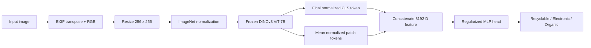

# Waste Material Image Classification

Image classification pipeline for **BDC Satria Data 2026**, built to sort solid-waste images into **Recyclable**, **Electronic**, and **Organic** material categories.

The final solution uses a **frozen DINOv3 ViT-7B** backbone through `timm`, extracts a compact representation from the final normalized **CLS token and mean patch tokens**, and trains a lightweight classification head on top. The submission reached **99.8869 Macro F1** and finished **24th out of 544 teams**.

## Competition Result

| Metric | Result |
| --- | ---: |
| Final Macro F1 | **99.8869** |
| Final Rank | **24 / 544 teams** |
| Training Images | **26,527** |
| Test Images | **1,458** |
| Classes | **3** |
| 5-Fold OOF Macro F1 | **0.990166** |

> The competition leaderboard reports Macro F1 on a 0–100 scale, while local `scikit-learn` validation uses the usual 0–1 scale.

## Problem

The competition asks participants to classify each waste image into one of three labels:

| Label | Class | Examples |
| ---: | --- | --- |
| `0` | Recyclable | plastic bottles, cans, paper, cardboard, glass |
| `1` | Electronic | phones, laptops, keyboards, chargers, cables |
| `2` | Organic | leaves, fruit, vegetables, food waste, plant matter |

Only the **visual content of the official images** may be used for prediction. External labels, metadata-derived features, and manual test labeling are outside the competition rules. See the provided [technical guide](docs/Petunjuk_Teknis_BDC_Satria_Data_2026.md) for the original task constraints.

## Final Approach



Key design choices:

- **Backbone:** `timm/vit_7b_patch16_dinov3.lvd1689m`
- **Backbone state:** fully frozen
- **Input resolution:** `256 × 256`
- **Readout:** final normalized CLS token + mean of normalized patch tokens
- **Validation:** 5-fold stratified cross-validation
- **Loss:** weighted cross-entropy with label smoothing
- **Optimizer:** AdamW with cosine learning-rate schedule
- **Model selection:** Macro F1
- **Inference:** single-model deterministic forward pass, without manual correction

The backbone is intentionally frozen because the 6.7B-parameter ViT-7B checkpoint is expensive to fine-tune under the competition hardware budget. Caching frozen embeddings also makes repeated head experiments much cheaper and easier to audit.

## What Was Tried

The project moved from conventional image-classification baselines toward large frozen self-supervised representations. The most useful findings were:

- ConvNeXt established a strong supervised baseline, but the frozen DINOv3 representations generalized better for the final submission.
- Scaling the frozen backbone to **DINOv3 ViT-7B** improved the representation quality substantially.
- Most remaining OOF errors were concentrated around the **Recyclable ↔ Organic** boundary, while Electronic was already close to saturation.
- Rich spatial readouts, material-aware patch attention, alternative resampling, second-order texture features, seed ensembling, and a last-block LoRA screen did **not** beat the locked final recipe robustly enough to replace it.
- The final recipe was therefore selected by validation evidence rather than by repeated leaderboard probing.

A compact experiment log is available in [`docs/EXPERIMENTS.md`](docs/EXPERIMENTS.md).

## Repository Structure

```text
waste-material-image-classification/
├── README.md
├── requirements.txt
├── .gitignore
├── docs/
│   ├── EXPERIMENTS.md
│   └── Petunjuk_Teknis_BDC_Satria_Data_2026.md
└── notebooks/
    ├── waste_material_classification_dinov3.ipynb
    └── experiments/
        ├── 01_convnext_baseline.ipynb
        ├── 02_dinov3_vitl_frozen.ipynb
        ├── 03_dinov3_vit7b_frozen.ipynb
        ├── 04_material_patch_attention.ipynb
        ├── 05_model_native_resampling.ipynb
        ├── 06_second_order_texture.ipynb
        ├── 07_seed_ensemble_diagnostics.ipynb
        └── 08_final_block_lora_screen.ipynb
```

The notebooks in this public repository are stored **without execution outputs**. Large feature caches, checkpoints, OOF predictions, submission CSVs, and result bundles are intentionally excluded.

## Dataset

The dataset is **not included** in this repository.

According to the competition technical guide:

- Train: **26,527** labeled images
- Test: **1,458** unlabeled images
- Dataset download: <https://bit.ly/datasetbdc2026>
- Submission template: <https://bit.ly/submissionbdc2026>

Expected training layout:

```text
data/
└── train/
    ├── 0_Recyclable/
    ├── 1_Electronic/
    └── 2_Organic/
```

The final notebook was designed for **Kaggle with 2× Tesla T4 GPUs**, internet enabled, and access to the gated DINOv3 checkpoint on Hugging Face.

## Setup

```bash
python -m venv .venv
source .venv/bin/activate       # Windows: .venv\Scripts\activate
pip install -r requirements.txt
```

For the final notebook, accept the DINOv3 model license on Hugging Face and provide an `HF_TOKEN` through the environment or Kaggle Secrets. The token is read at runtime and should never be committed to Git.

## Reproducibility Notes

The final notebook includes checks for deterministic seeds, dataset structure, model revision, preprocessing, feature-cache identity, train/test isolation, and submission format. It is intentionally strict because the competition limits predictions to information contained in the official images.

The final local OOF score for the locked control recipe was **0.990166 Macro F1**. Per-class OOF F1 was approximately **0.9864 Recyclable**, **0.9943 Electronic**, and **0.9898 Organic**.

## Tech Stack

`Python` · `PyTorch` · `timm` · `DINOv3` · `scikit-learn` · `pandas` · `NumPy` · `Pillow` · `Hugging Face Hub`

## Notes

This repository is a cleaned portfolio version of the competition workspace. It keeps the final reproducible notebook and a curated experiment trail while excluding datasets, large generated artifacts, private working notes, external reference notebooks, and model/result files.
